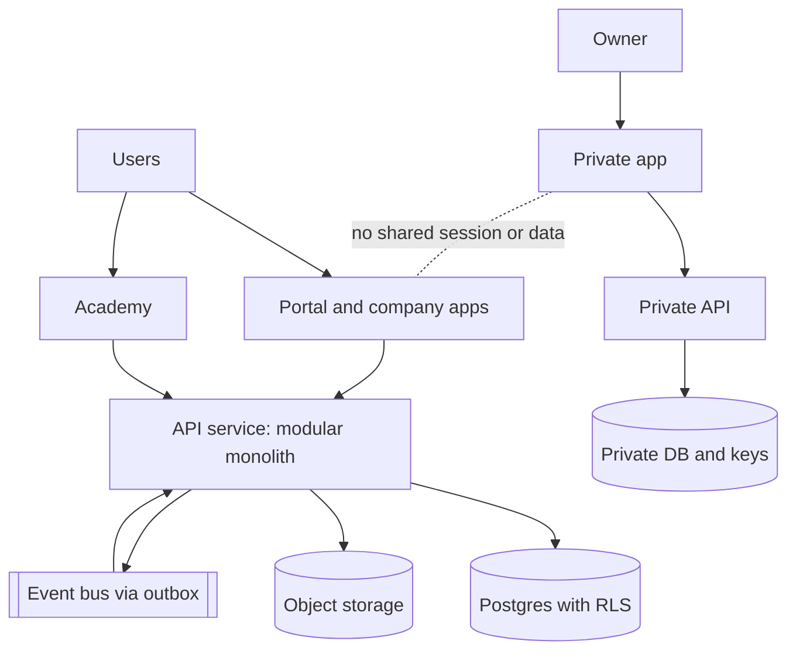
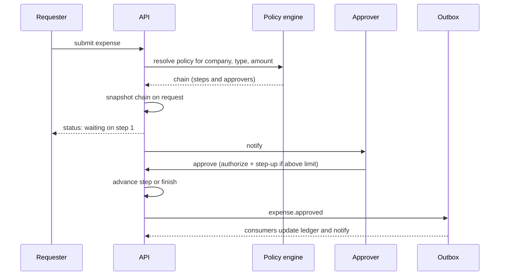

# Wolf Intelligence: architecture and build spec

Status: proposed baseline. Audience: the owner and the AI coding agent that will build this.
Read sections 0 to 3 before writing any code. Section 12 is the agent's rulebook.

---

## 0. Goals and non-negotiables

Wolf Intelligence is one platform for a group of companies (BZG, AMG, GGV), with shared services, company workspaces, a group-wide Academy, and an isolated owner private domain.

Non-negotiables. If a task conflicts with one of these, stop and ask.

1. Authorization is enforced on the server, on every request, in one place. Hiding UI is never security.
2. Company data is isolated by default: application checks plus database row-level security.
3. The owner private domain is a separate system with its own project, database, keys, and login. It is not a module.
4. Every sensitive read or change is recorded in an append-only audit log.
5. Decisions that are expensive to reverse (tenancy, identity, IDs, money, time) are made now, in this document. Everything else stays flexible.

### Who uses it

| Persona | Notes |
|---|---|
| Owner | Group-wide view, approvals, plus the private domain on its own track |
| Staff (everyone except Owner) | Base account: staff workspace, HRIS self-service, Academy learner |
| Add-on holders | Staff with extra capabilities: finance app, HR admin, Content Machine, approver rights |
| Group executive | An add-on bundle: approved cross-company dashboards and delegated approvals |
| Developer | Technical console. Production business data masked by default |

Key modelling rule: there are no separate "kinds" of user. There is one base person plus granted capabilities (section 5). A person may belong to several companies, and that never implies access to all of their data.

---

## 1. Layers

```
Clients (Next.js apps)       portal | academy | content-machine | private (separate)
        |
Edge                         WAF, rate limiting, TLS
        |
API service (modular monolith, one deployable)
   group layer:   identity | access | core (files, notifications, audit, search) | academy
   integration:   outbox -> event bus -> consumers (approved projections only)
   company layer: hr | finance | content   (every row carries company_id)
        |
Data                         Postgres (RLS)  |  Object storage  |  Pub/Sub
   
Private domain (separate GCP project)
   own API, own database, own KMS keys, own identity pool, own audit log
```

Principles:

- Modular monolith first. One backend deployable with strict internal module boundaries. Do not start with microservices. Split a module out only when there is a measured reason.
- Next.js apps never touch the database. They call the API only. This gives exactly one enforcement point.
- Modules talk through public interfaces and events, never through each other's tables.
- The private domain shares nothing with the rest at runtime: no shared database, service account, search index, analytics, or log sink.

### Diagram: system context



---

## 2. Technology decisions

Defaults are chosen to match the existing stack (Next.js, TypeScript, pnpm, Google Cloud). Each has a reason, so the agent should not swap them casually.

| Area | Decision | Why |
|---|---|---|
| Monorepo | pnpm workspaces + Turborepo | Already in use |
| Frontend | Next.js (App Router) + TypeScript, Tailwind, shadcn/ui, TanStack Query/Table, React Hook Form + Zod | Matches the Figma design system |
| API service | Node + TypeScript, NestJS or Fastify with a strict module structure | Modules map to bounded contexts |
| Contracts | Zod schemas in `packages/contracts`, OpenAPI generated, typed client generated into `packages/api-client` | One source of truth for front end, back end, and the agent |
| Database | PostgreSQL (Cloud SQL), not Firestore, for the system of record | Relational data, transactions, row-level security, reporting, audit. Firestore is a poor fit for finance and HR |
| ORM and migrations | Drizzle (or Prisma) with versioned SQL migrations; RLS policies written as raw SQL in migrations | Keeps schema in code, policies explicit |
| Events | Transactional outbox table, relayed to Pub/Sub | No lost or phantom events |
| Files | Cloud Storage, metadata in Postgres, short-lived signed URLs after an authorization check | No public buckets |
| Secrets and keys | Secret Manager and Cloud KMS | Nothing sensitive in the repo or env files |
| Hosting | Cloud Run (API and Next.js apps), region `asia-southeast2` (Jakarta) unless data residency advice says otherwise | Closest region, one cloud |
| CI/CD | GitHub Actions with Workload Identity Federation, no long-lived cloud keys | Safer deploys |
| Environments | `dev`, `staging`, `prod` as separate cloud projects. Private domain adds its own project(s) | Blast-radius control |
| i18n | English first, Indonesian-ready from day one (message catalogs, no hard-coded strings) | Retrofitting is painful |

### Identity provider (decision gate D1)

Default: Google Identity Platform (Firebase Auth upgraded), because the team already uses Firebase.

Gate for week 1: confirm in a spike that the chosen provider supports all of the following. If it fails any, switch to a self-hosted or alternative OIDC provider (for example Better Auth or Zitadel) before building on it.

- Passkeys (WebAuthn) and TOTP MFA, with MFA enforceable per user group
- Server-side session revocation
- A way to read the time of last authentication (for step-up checks)
- Admin API to disable users and revoke sessions

Lock-in protection, required either way: the platform owns its own `users.id` (UUID). The provider is linked through an `auth_identities` table (`provider`, `subject`, `user_id`). No table references the provider's ID directly.

---

## 3. Cross-cutting rules that prevent later pain

These are the decisions that are expensive to change after data exists.

1. IDs: UUIDv7 primary keys (time-ordered). Never expose sequential integers.
2. Money: integer minor units plus an ISO currency code. Never floats. Never a bare number.
3. Time: `timestamptz` in UTC everywhere. Store the user's and company's timezone separately. Date-only business facts (hire date) use `date` plus the company timezone.
4. Tenancy: every company-scoped table has `company_id NOT NULL`, indexed, and covered by RLS (section 4).
5. Effective dating: employment, roles, grants, reporting lines, and approval policies carry `valid_from` and `valid_to`. History is kept, not overwritten.
6. Soft delete plus retention: records are archived with `deleted_at`, and real deletion happens only through a retention job with a logged reason.
7. Snapshots for in-flight work: a request stores a copy of the approval chain used when it was submitted, so changing rules later never rewrites history.
8. Idempotency: every mutating endpoint accepts an idempotency key. Every event consumer is idempotent.
9. Versioned everything: API (`/v1`), event schemas, policy versions, migrations.
10. Migrations: forward-only, expand-then-contract, one deploy per step. Never edit a migration that has run in any shared environment.
11. No production data outside production. Dev and staging use generated fake data only.
12. PII minimization: store only what a feature needs. Events carry IDs and the minimum fields, never whole records.

---

## 4. Database design

### 4.1 Schemas (Postgres schemas, one per module)

`identity`, `access`, `org`, `core`, `audit`, `hr`, `finance`, `academy`, `content`, `integration`.

Each module owns its schema. Other modules do not query it directly. They use the module's public service or a read model.

### 4.2 Core tables (key columns only)

**identity**
- `users` (id, email, display_name, status[active|suspended|disabled], created_at). Minimal data only. No HR PII here.
- `auth_identities` (id, user_id, provider, subject)
- `sessions` (id, user_id, created_at, last_seen_at, auth_level, auth_time, device_info, revoked_at)

**org**
- `companies` (id, code[BZG|AMG|GGV], name, timezone, currency_default, status)
- `employments` (id, user_id, company_id, employee_no, status, valid_from, valid_to). One user can have many.
- `departments`, `positions`
- `reporting_lines` (employment_id, manager_employment_id, valid_from, valid_to)

**access**
- `permissions` registry (key such as `finance.expense.approve`, description, default_classification)
- `roles` (id, company_id nullable, name, is_system) and `role_permissions` (role_id, permission_key)
- `grants` (id, user_id, role_id, scope_type[group|company|department|self], scope_id, valid_from, valid_to, granted_by, reason, ticket_ref)
- `access_requests` (id, user_id, requested_role_id, scope, status, decided_by, decided_at, reason)
- `break_glass_sessions` (id, user_id, scope, reason, approved_by, starts_at, ends_at)

**hr** (all company-scoped)
- `employee_profiles` (id, employment_id, company_id, personal fields, classification per field)
- `onboarding_plans` and `onboarding_tasks`, `leave_requests`, `documents`

**finance** (all company-scoped)
- `expenses` (id, company_id, requester_employment_id, amount_minor, currency, status, ...), `vendors`, `ledger_entries` (append-only)

**approvals** (in `core`, used by finance, HR, access)
- `approval_policies` (id, company_id, request_type, version, valid_from, valid_to)
- `approval_policy_steps` (policy_id, step_no, approver_rule, condition on amount or attributes)
- `approval_requests` (id, company_id, request_type, subject_id, requester_id, policy_id, policy_version, chain_snapshot jsonb, status)
- `approval_steps` (request_id, step_no, approver_user_id, status, decided_at, comment)
- `delegations` (from_user_id, to_user_id, scope, valid_from, valid_to)

**academy**
- `courses`, `course_versions`, `course_assignments` (target_type[person|role|department|company], target_id, due_date), `enrollments`, `progress`, `certificates`

**core**
- `files` (id, company_id nullable, owner_id, classification, storage_key, checksum, scan_status)
- `notifications`, `outbox_events` (id, aggregate, type, payload, version, created_at, published_at)

**audit**
- `events` (id, occurred_at, actor_user_id, session_id, company_id nullable, action, resource_type, resource_id, outcome[allow|deny], ip, user_agent, request_id, changes jsonb redacted). The application role has INSERT only: no UPDATE or DELETE grant. Partition by month.

### 4.3 Why employee PII is not on `users`

A person can belong to several companies. If personal HR data sat on one global user row, any cross-company access mistake would leak all of it. Therefore personal data lives on `employee_profiles`, scoped to one employment and one company, with a classification on sensitive fields.

### 4.4 Row-level security (defense in depth)

Application checks come first. RLS is the net underneath them.

```sql
ALTER TABLE finance.expenses ENABLE ROW LEVEL SECURITY;
ALTER TABLE finance.expenses FORCE ROW LEVEL SECURITY;

CREATE POLICY company_isolation ON finance.expenses
  USING (company_id = ANY (string_to_array(current_setting('app.company_ids', true), ',')::uuid[]));
```

Rules:

- On each request, inside a transaction, the API runs `SET LOCAL app.user_id = ...` and `SET LOCAL app.company_ids = ...`. Use `SET LOCAL` only, so it is safe behind transaction-mode connection pooling.
- The application database role has no `BYPASSRLS` and does not own the tables. A separate migration role owns and alters them.
- Add a CI test that fails if any table with a `company_id` column lacks RLS.
- Tenancy option for later: if BZG, AMG, and GGV are separate legal entities that need hard separation, move to schema-per-company or database-per-company. Because every row already has `company_id` and all access goes through repository classes, this is a contained change. Decision gate D2.

### 4.5 Data classification

| Level | Examples | Rule |
|---|---|---|
| 0 Public | Company news | Any authenticated user |
| 1 Internal | Org chart, course catalog | Company members |
| 2 Confidential | Payroll, bank details, expense data | Needs a specific permission, is masked in lists, logged on read |
| 3 Restricted | Medical, disciplinary, private-domain links | Never granted through broad roles. Per-record or per-field grant, logged, step-up auth required |

---

## 5. Authorization model

RBAC for "what is this person generally allowed to do", ABAC for "does this specific request meet the conditions".

### 5.1 Base plus add-ons

- Every employee gets the base grant set automatically through their employment: staff workspace, HRIS self-service (own data only), Academy as learner.
- Add-ons are `grants` scoped to a company (or department, or the whole group): finance, HR admin, Content Machine, approver rights, executive dashboards.
- Group-wide scope is rare and explicit. It never includes level 3 data.

### 5.2 One decision function

Every protected operation calls this. No endpoint authorizes on its own.

```ts
authorize(
  ctx: { userId: string; sessionId: string; authLevel: number; authTime: Date; companyId?: string },
  action: PermissionKey,                       // e.g. "finance.expense.approve"
  resource?: {
    type: string; id?: string; companyId?: string;
    ownerUserId?: string; classification?: 0|1|2|3; attrs?: Record<string, unknown>;
  }
): Decision

type Decision = {
  allow: boolean;
  reason: string;                              // for logs and "why can't I see this" UI
  obligations: Array<"mask:field" | "require_step_up" | "log_read" | "limit:rows">;
}
```

What it evaluates: active grants (date-valid) matching the scope, the user's employment in the resource's company, ownership, amount limits, classification, and whether step-up authentication is required and fresh.

Why obligations matter: a permitted read can still require masking a field or a recent re-authentication. The front end renders what the obligations say.

Policy engine: start with this in-house module behind that single interface. If rules grow complex, the interface lets you swap in Cerbos or OpenFGA without touching endpoints.

### 5.3 Rules for tokens and permission freshness

- The session token carries only: `user_id`, `session_id`, `auth_level`, `auth_time`. It does not carry permissions.
- Permissions are resolved on the server for each request and cached by `grants_version` (a per-user counter bumped on every grant, role, or employment change). A bump makes revocation effective on the next request, not at token expiry.
- Developers get no production business data grants. Production access is break-glass only: time-limited, approved, reasoned, and fully logged.

### 5.4 Temporary access and emergencies

- `access_requests` workflow for add-ons, with expiry on every grant.
- `break_glass_sessions` for emergency access: approver required, maximum duration, an alert to the owner, and a mandatory post-review.

---

## 6. Authentication and sessions

- MFA is mandatory for owner, finance, HR admin, developers, and anyone holding an approver or admin grant. Passkeys preferred. Staff may use passkey or password plus TOTP.
- Web sessions: server-side session record plus an httpOnly, Secure, SameSite=Lax cookie, host-only (no wide domain cookies). Short idle timeout (for example 30 minutes for admin add-ons), longer for ordinary staff.
- Step-up authentication: sensitive actions (export, payroll view, grant changes, approving above a limit, viewing level 3 data) require `auth_time` within the last N minutes, otherwise re-prompt. The `authorize()` obligation `require_step_up` drives this.
- Offboarding is one transaction: end employments, expire grants, revoke all sessions, disable the user if no active employment remains, reassign or escalate pending approvals, keep records.
- Recovery: no email-only recovery for owner, finance, or admins. Define a recovery path before launch (second passkey, recovery codes stored offline, owner-approved reset for others).
- CSRF protection on cookie-authenticated mutations, strict CORS, rate limiting on login, reset, and MFA endpoints, account lockout with alerts.

### Private domain authentication

The private app has its own identity pool with the owner as the only user, a passkey required, no shared session with the portal, short sessions, and a fresh passkey prompt before sensitive views and exports. The portal launcher only links to it and passes no identity or data.

---

## 7. Integration layer

- Modules never read each other's tables. They publish events through the outbox: `employee.created`, `employment.ended`, `grant.changed`, `expense.approved`, `course.assigned`.
- Each event is versioned, carries IDs and only the minimum fields, and is delivered at least once. Consumers are idempotent.
- Consumers build their own read models. Example: finance keeps `finance.employee_ref` (employment id, name, cost centre) fed by `employee.created`, with no access to the HR database.
- Dead-letter queue for failed events, with an admin view and alerts.
- External or future integrations go through the same contracts (OpenAPI, scoped API keys, per-key rate limits and audit).

---

## 8. Private owner domain (isolation requirements)

- Separate cloud project, separate database, separate service identity, separate KMS key ring. No cross-project service account access to or from the main platform.
- Customer-managed encryption keys for storage. For the most sensitive notes and files, client-side encryption (Web Crypto) so the server never holds plaintext. Plan key recovery (offline recovery key) before enabling it, because lost keys mean lost data.
- Excluded from: group search, AI indexing, shared analytics, support tooling, exports, error-tracking payloads, and logs. The private app logs events, never content.
- `noindex` headers, no third-party scripts, strict CSP.
- Be honest about the limit: a separate database alone does not stop a cloud administrator with enough privileges. Only client-side encryption does. Choose per data type.
- Provision the project and baseline controls early, even though the app is built later. Isolation is hard to retrofit.

---

## 9. Key flows

### 9.1 Login to launcher
1. User signs in (passkey, or password plus MFA). Provider confirms identity.
2. API maps the provider subject to `users.id`, creates a `sessions` row, sets the cookie.
3. Launcher call returns the companies and apps the user is entitled to (base plus add-ons). One company means skip the picker.
4. Every later request: session lookup, `authorize()`, RLS context set, audit written if sensitive.

### 9.2 Employee onboarding (HR in AMG)
1. HR creates the employee. API writes `users`, `employments`, `employee_profiles`, and an `employee.created` outbox event in one transaction.
2. Identity provisions the login and sends a secure activation link.
3. Access assigns the base grants and any role bundle chosen by HR.
4. Academy assigns courses for the role and department.
5. Finance receives the minimal employee reference through the event.
6. The employee's first screen shows their courses and welcome tasks, and never sees other companies.

### 9.3 Offboarding
Transactional steps listed in section 6. Pending approvals are escalated, not dropped.

### 9.4 Access request and grant
User requests an add-on, the approver decides, and a grant is created with an expiry and a reason. `grants_version` bumps. The audit log records it. Notifications go to both parties.

### 9.5 Approval (configurable)



- Approval rules are data (`approval_policies`), editable by company admin or owner with their own permission, versioned, and audited.
- The submitted request keeps its snapshot, so edits never change in-flight requests.
- Absent approvers escalate to the company admin, or follow an active `delegation`.
- Default rule until the hierarchy is decided: direct manager approves, a second approver joins above a threshold, and the owner joins above a higher one. Decision gate D3.

### 9.6 Developer break-glass
Developer requests production access with a reason. An approver confirms. A time-boxed session starts, the owner is alerted, all actions are logged, and review is required afterwards.

### 9.7 Entering the private space
Portal shows a link only. The private app runs its own passkey login and issues its own short session. Nothing is shared from the portal.

---

## 10. Quality, security, and operations

Authorization test matrix (most important test suite): a table of roles by resources by actions, generated into automated tests. It must run in CI and block merges. Include negative cases: wrong company, expired grant, revoked session, missing step-up, level 3 data.

Other required checks:
- RLS test: queries as company A cannot see company B rows, even with a bug in application code.
- Contract tests between API and generated client.
- Playwright journeys per persona: staff, HR, finance, executive, developer, owner.
- Migration test on a copy of staging data before each production deploy.
- Dependency and secret scanning in CI.

Security baseline: WAF (Cloud Armor), HSTS, strict CSP, security headers, input validation with Zod at every boundary, file upload type and size limits with malware scanning before a file becomes downloadable, least-privilege service accounts, no public buckets or databases.

Observability: structured logs with a request ID, PII redaction at the logger, error tracking with payload scrubbing, metrics and alerts on login failures, permission denials, outbox lag, and dead letters. Audit log is separate from application logs.

Backups and recovery: automated backups with point-in-time recovery, restore drills each quarter, encrypted backups, documented RPO and RTO.

Compliance: personal data handling will need to follow Indonesia's personal data protection law (UU PDP). Plan data subject requests, retention schedules, and breach response early, and confirm details with qualified counsel.

---

## 11. Build phases and definition of done

Do not skip phase 1. Everything else depends on it.

| Phase | Scope | Done when |
|---|---|---|
| 0. Foundations | Repo structure, environments, CI/CD, secrets, private-domain project provisioned, identity spike (gate D1) | Hello-world deploys to dev and staging through CI. D1 decided |
| 1. Trust core | `identity`, `access`, `org`, `audit`, `authorize()`, sessions, MFA, step-up, RLS framework, outbox, authorization test matrix | Login works. Matrix and RLS tests pass in CI. Audit log verified append-only |
| 2. Shell and admin | Design-system package, app shell, launcher, company switcher, user and grant admin, access requests | Each persona sees only their sections. Locked sections show "Request access" |
| 3. HR and Academy | Employee records, onboarding and offboarding, courses, assignments, progress | Onboarding flow works end to end across modules through events |
| 4. Approvals and Finance | Policy engine, rule editor, request and inbox screens, expenses, ledger | Rules editable without code. In-flight snapshots proven by test |
| 5. Content Machine (GGV) | GGV-scoped module | Works under the same authorization and audit model |
| 6. Private app | Separate app, API, database, keys, client-side encryption, own login | Isolation checklist in section 8 passes review |

---

## 12. Rules for the AI agent

1. Read sections 0 to 3 first. Never contradict them. If you must, stop and ask the owner.
2. Every API endpoint declares its required permission and calls `authorize()`. No endpoint without it. No inline role checks.
3. Every new company-scoped table gets `company_id NOT NULL`, an index, RLS enabled and forced, and a test.
4. Next.js code never connects to the database and never contains secrets.
5. Business data never goes to logs, error trackers, analytics, or search indexes unless it is explicitly classified level 0 or 1.
6. Money is integer minor units plus currency. Time is UTC `timestamptz`. IDs are UUIDv7.
7. Cross-module data flows through events or public service interfaces, never direct table access.
8. Every sensitive read or change writes an audit event in the same transaction.
9. Migrations are forward-only and reviewed. Never edit one that has already been applied.
10. Use generated contracts (`packages/contracts`, `packages/api-client`). Do not hand-write API types.
11. Do not touch anything related to the private domain from the main codebase. It lives in its own repo area and project with its own rules.
12. When a requirement is unclear, add a note to the Open Decisions list below and use the stated default. Do not invent a permanent answer.
13. Add or update tests with every change. A change to permissions must update the authorization matrix.
14. Prefer boring, well-known libraries. Do not add a dependency without stating why.
15. Use fake generated data in all non-production environments.

---

## 13. Open decisions and defaults

| ID | Decision | Default until decided | Revisit |
|---|---|---|---|
| D1 | Identity provider | Google Identity Platform, pending week-1 spike | End of phase 0 |
| D2 | Tenancy: shared database with RLS or per-company isolation | Shared database, RLS, `company_id` everywhere | Before phase 3, after legal review |
| D3 | Approval hierarchy | Configurable rules, default chain in section 9.5 | When the org chart is settled |
| D4 | Currencies | One default currency per company, amounts stored with currency code | Before finance goes live |
| D5 | Data residency | `asia-southeast2` (Jakarta) | After legal advice |
| D6 | Retention periods per data type | Retain, archive, do not delete | Before phase 3 |
| D7 | Languages | English with Indonesian-ready catalogs | Before first staff rollout |
| D8 | Private-domain client-side encryption scope | Notes and files only, recovery key required | Before phase 6 |

---

## 14. What this design protects you from

| If skipped | What goes wrong later |
|---|---|
| Single `authorize()` and server-side checks | Permissions drift between endpoints. A missed check leaks data |
| RLS in the database | One application bug exposes another company's records |
| Employee PII scoped per employment | A cross-company slip leaks a person's whole HR file |
| Permissions out of the token, with `grants_version` | Revoked access keeps working until the token expires |
| Identity provider linked by mapping table | Changing providers means rewriting every table |
| Approval snapshot on each request | Editing a rule changes or breaks requests already in flight |
| Integer money and UTC time | Rounding errors, wrong month-end totals, daylight-saving surprises |
| Outbox plus idempotent consumers | Missing or duplicated onboarding, notifications, and ledger entries |
| Separate private project and keys | Owner data reachable through ordinary operations or a developer account |
| Authorization test matrix in CI | Regressions that silently open access |
| Effective-dated grants and employment | You cannot answer "who had access on this date" for an audit |
